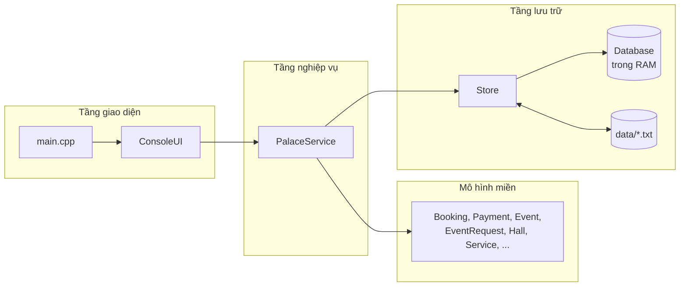
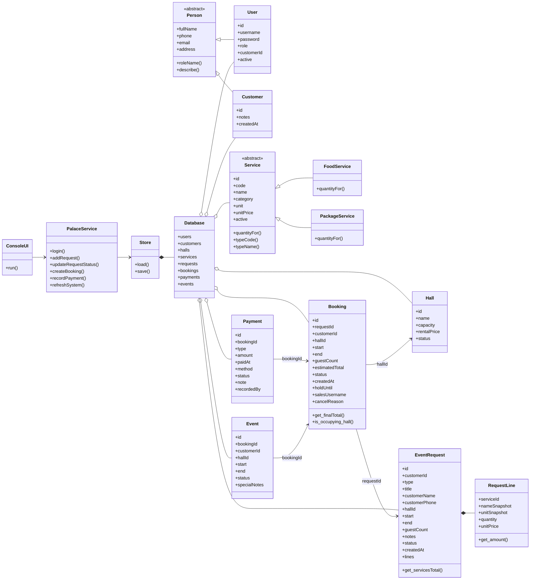
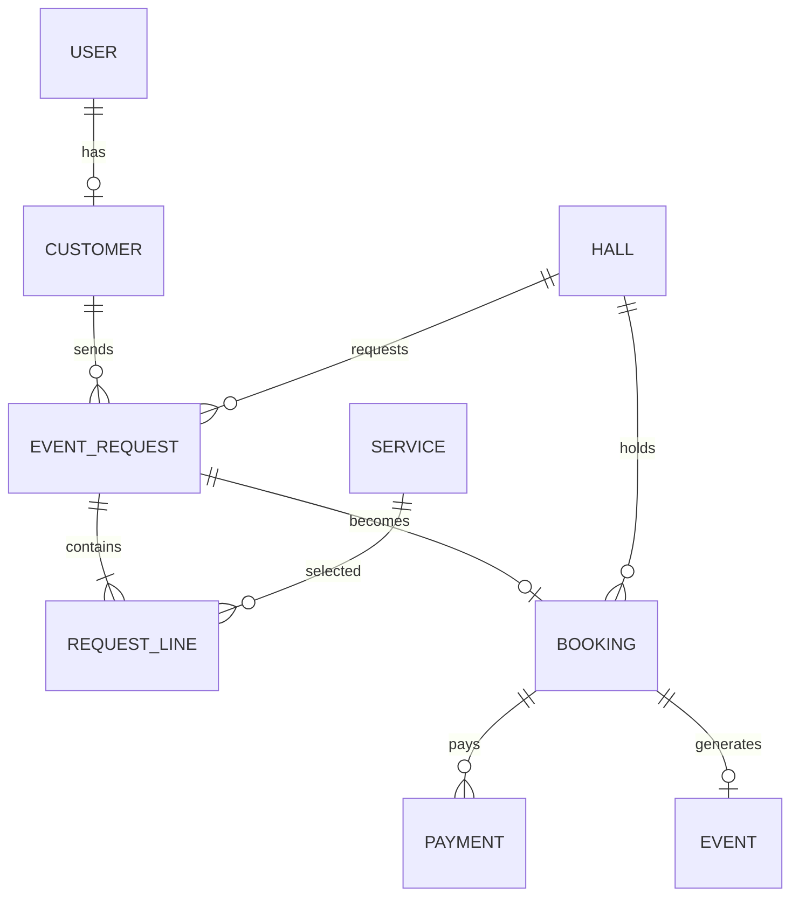
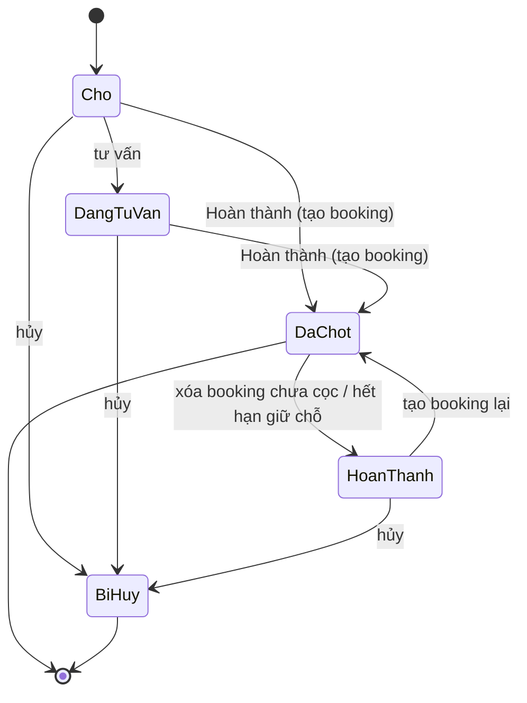
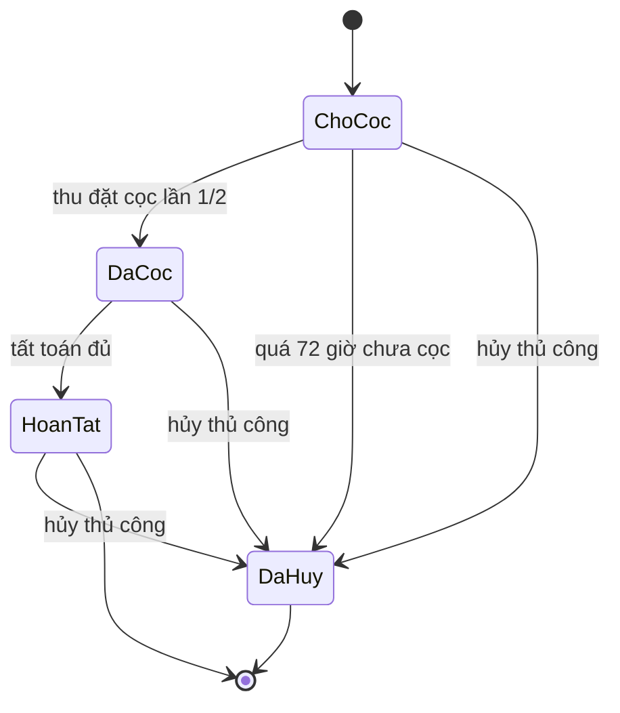
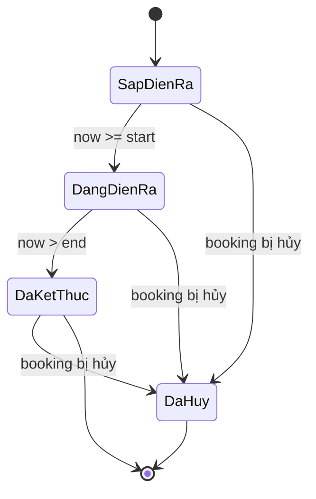
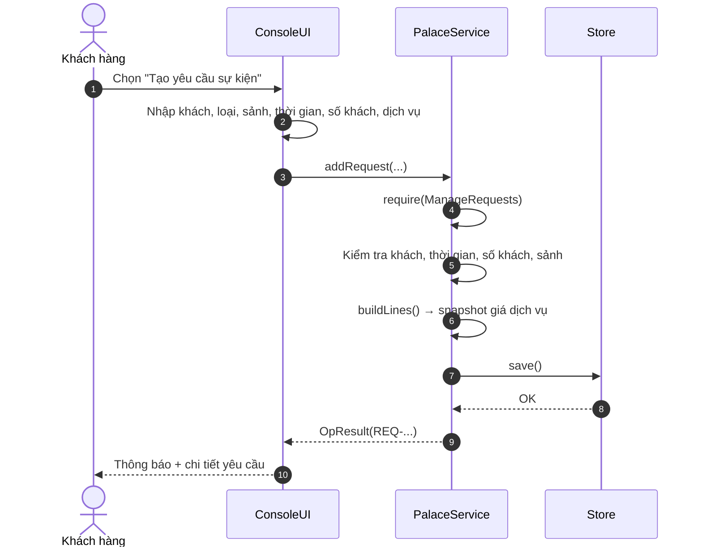
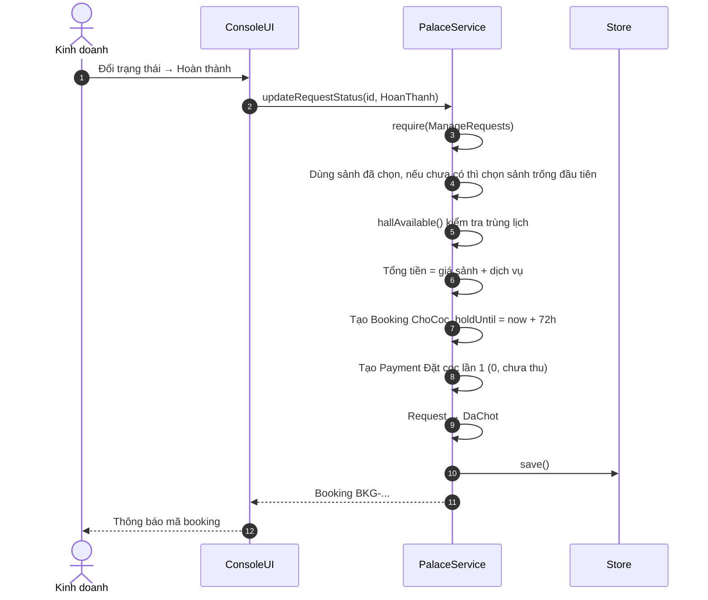
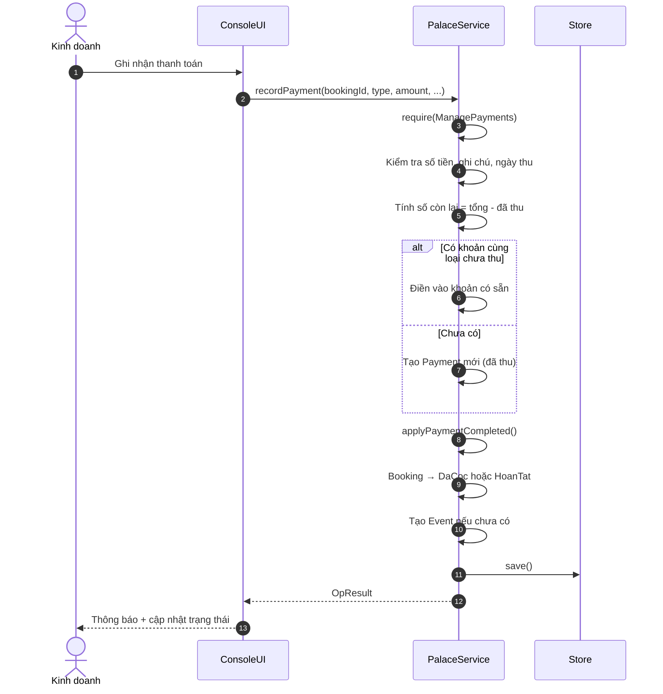
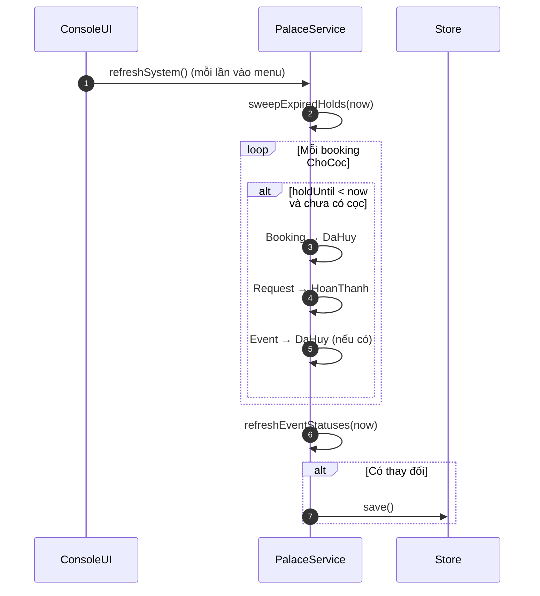

# Kiến trúc hệ thống Trống Đồng Palace

Tài liệu dành cho người đọc code, bảo vệ đồ án và người muốn mở rộng hệ thống.
Nội dung bám theo bản **console + lưu file TXT** hiện tại.

---

## 1. Mục tiêu và ràng buộc

### 1.1. Mục tiêu

- Mô phỏng đúng quy trình đặt lịch sự kiện: yêu cầu → tư vấn → booking → cọc → tất toán → sự kiện.
- Tách rõ **giao diện**, **nghiệp vụ** và **lưu trữ** để dễ đọc, dễ sửa, dễ bảo vệ.
- Toàn bộ quy tắc quan trọng nằm ở một nơi: `PalaceService`.
- Chạy được trên Windows/Linux/macOS, không cần cài database hay thư viện ngoài.

### 1.2. Ràng buộc

| Ràng buộc | Hệ quả thiết kế |
| :--- | :--- |
| C++17, không thư viện ngoài | Tự viết `DateTime`, đọc/ghi file bằng `fstream`, dùng STL |
| Giao diện console | `ConsoleUI` nhập/xuất tuần tự, không có sự kiện chuột/đồ họa |
| Một người dùng tại một thời điểm | Không cần khóa, transaction hay đồng bộ đa luồng |
| Lưu file text | Mỗi lần thay đổi ghi lại toàn bộ 9 file; dữ liệu dễ đọc, dễ sửa tay |
| Đồ án học thuật | Ưu tiên dễ hiểu hơn tối ưu hiệu năng |

---

## 2. Sơ đồ tổng quan



Luồng phụ thuộc một chiều:

```text
main → ConsoleUI → PalaceService → Store → Database
                                  ↘ Entity
```

- **Không** có mũi tên ngược từ `Store`/entity lên `ConsoleUI`.
- `ConsoleUI` không sửa trực tiếp `Database`; mọi thay đổi đi qua service.
- `Store` không quyết định nghiệp vụ; nó chỉ đọc/ghi.

---

## 3. Phân lớp trách nhiệm

| Tầng | Thành phần | Trách nhiệm | Không làm |
| :--- | :--- | :--- | :--- |
| Khởi động | `main.cpp` | Bật UTF-8, xác định `data/`, tạo `Store` → `PalaceService` → `ConsoleUI`, chạy vòng lặp | Nghiệp vụ |
| Giao diện | `ConsoleUI` | Menu, nhập liệu, bảng, thông báo, điều hướng `b`/`m` | Sửa dữ liệu, kiểm tra trùng lịch |
| Nghiệp vụ | `PalaceService` | Phân quyền, kiểm tra hợp lệ, tính tiền, chuyển trạng thái, gọi lưu file | In menu, đọc bàn phím |
| Miền | `Person`, `User`, `Customer`, `Hall`, `Service`, `EventRequest`, `Booking`, `Payment`, `Event`, `DateTime` | Dữ liệu + hành vi nhỏ (`toText`, `fromText`, `get_amount`, `is_occupying_hall`) | Gọi UI/service |
| Lưu trữ | `Store`, `Database` | Giữ vector đối tượng, đọc/ghi `data/*.txt` | Quyết định nghiệp vụ |
| Tiện ích | `Utils`, `Enums` | Chuỗi, tiền, ngày, ID, enum, exception | Trạng thái toàn cục |

### 3.1. Vì sao tách `PalaceService` thành 3 file?

| File | Nhóm chức năng |
| :--- | :--- |
| `src/PalaceService.cpp` | Đăng nhập, phân quyền, tài khoản, khách hàng, lưu file, tiện ích |
| `src/PalaceRequest.cpp` | Yêu cầu sự kiện, dòng dịch vụ, tính giá, chuyển trạng thái |
| `src/PalaceBooking.cpp` | Sảnh, dịch vụ, booking, thanh toán, sự kiện, quét hết hạn |

Ba file cùng cài đặt **một lớp** `PalaceService`. Cách tách này giữ API tập trung trong
`include/PalaceService.h` nhưng tránh một file `.cpp` quá dài.

---

## 4. Bản đồ mã nguồn

```text
main.cpp
├── đọc data/ (hoặc ../data)
├── Store::load()
└── ConsoleUI::run()

include/
├── Enums.h              enum + chuyển đổi text
├── DateTime.h           ngày giờ, so sánh, cộng giờ
├── Person.h             lớp cơ sở trừu tượng
├── User.h / Customer.h  hai lớp con của Person
├── Hall.h               sảnh
├── Service.h            Service trừu tượng + FoodService/PackageService
├── EventRequest.h       EventRequest + RequestLine
├── Booking.h            booking + hạn giữ chỗ
├── Payment.h            khoản thu
├── Event.h              sự kiện
├── Store.h              Database + Store
├── PalaceService.h      API nghiệp vụ + Action + ServiceLineInput
├── ConsoleUI.h          giao diện
└── Utils.h              template, exception, hàm tiện ích
```

---

## 5. Mô hình miền

### 5.1. Sơ đồ lớp



### 5.2. Ý nghĩa các lớp

| Lớp | Vai trò | Ghi chú |
| :--- | :--- | :--- |
| `Person` | Thông tin chung của con người | Lớp trừu tượng; `roleName()` thuần ảo, `describe()` ảo có cài đặt |
| `User` | Tài khoản đăng nhập | Kế thừa `Person`; có `role()`, `active()`, `customerId()` |
| `Customer` | Hồ sơ khách hàng | Kế thừa `Person`; có `notes`, `createdAt` |
| `Hall` | Sảnh tiệc | Sức chứa, giá thuê, trạng thái |
| `Service` | Dịch vụ | Trừu tượng; hai lớp con `FoodService`, `PackageService` |
| `EventRequest` | Yêu cầu sự kiện | Chứa `vector<RequestLine>`; trạng thái nghiệp vụ |
| `RequestLine` | Một dòng dịch vụ đã chọn | Lưu **snapshot** tên, đơn vị, đơn giá |
| `Booking` | Giữ chỗ sảnh | Có `holdUntil` = lúc tạo + 72 giờ |
| `Payment` | Khoản thu | Đặt cọc 1/2 hoặc tất toán |
| `Event` | Sự kiện thực tế | Sinh ra sau lần thu tiền đầu tiên |
| `Database` | Tập hợp vector | Không phải database thật; chỉ là bộ nhớ trong |
| `Store` | Đọc/ghi file | Sở hữu `Database`; quản lý vòng đời `Service*` |
| `PalaceService` | Facade nghiệp vụ | Nơi duy nhất được sửa dữ liệu qua API |
| `ConsoleUI` | Giao diện | Chỉ gọi service và hiển thị |

### 5.3. Quan hệ và khóa tham chiếu

Hệ thống dùng **khóa chuỗi** thay vì con trỏ giữa các thực thể:

| Từ | Đến | Khóa |
| :--- | :--- | :--- |
| `User` | `Customer` | `customerId` (có thể rỗng với nhân viên) |
| `EventRequest` | `Customer` | `customerId` |
| `EventRequest` | `Hall` | `hallId` (có thể rỗng) |
| `RequestLine` | `Service` | `serviceId` |
| `Booking` | `EventRequest`, `Customer`, `Hall` | `requestId`, `customerId`, `hallId` |
| `Payment` | `Booking` | `bookingId` |
| `Event` | `Booking`, `Customer`, `Hall` | `bookingId`, `customerId`, `hallId` |

### 5.4. Sơ đồ quan hệ dữ liệu (ER)



Đây là quan hệ **logic** qua khóa chuỗi, không phải khóa ngoại vật lý trong file TXT.

Quy ước mã:

| Tiền tố | Thực thể | Ví dụ |
| :--- | :--- | :--- |
| `USR-` | Tài khoản | `USR-0001` |
| `CUS-` | Khách hàng | `CUS-0001` |
| `HAL-` | Sảnh | `HAL-0001` |
| `SVC-` | Dịch vụ | `SVC-0001` |
| `REQ-` | Yêu cầu | `REQ-0001` |
| `BKG-` | Booking | `BKG-0001` |
| `PAY-` | Thanh toán | `PAY-0001` |
| `EVT-` | Sự kiện | `EVT-0001` |

Mã được sinh bởi `nextId(prefix, danh sách id)` trong `Utils`: tìm số lớn nhất cùng tiền tố
rồi cộng 1, định dạng 4 chữ số.

---

## 6. Luồng nghiệp vụ

### 6.1. Trạng thái yêu cầu sự kiện



Ghi chú:

- `HoanThanh` là trạng thái **trung gian** sau khi booking bị xóa hoặc hết hạn giữ chỗ;
  khi tạo booking thành công, yêu cầu chuyển `DaChot`.
- Khách hàng chỉ được hủy yêu cầu của mình; không được đổi sang trạng thái khác.
- `DaChot` và `BiHuy` là trạng thái kết thúc (trừ khi booking bị xóa để quay về `HoanThanh`).

### 6.2. Trạng thái booking



- Booking `ChoCoc` / `DaCoc` / `HoanTat` đều **chiếm lịch sảnh**.
- Chỉ `DaHuy` giải phóng lịch.
- Hủy thủ công giữ lại booking và lý do; xóa chỉ dành cho booking chưa cọc (hoặc đã hủy)
  và chưa có khoản thu đã thanh toán.

### 6.3. Trạng thái sự kiện



Trạng thái được tính lại mỗi lần gọi `refreshSystem()` (mỗi lần vào menu hoặc xem sự kiện),
dựa trên đồng hồ máy. Sự kiện `DaHuy` không bị tính lại.

### 6.4. Tạo yêu cầu



Điểm quan trọng:

- Khách hàng luôn bị ép `customerId` theo tài khoản đang đăng nhập.
- Nếu khách sửa tên/SĐT trên form, hồ sơ `Customer` được cập nhật ngược lại.
- Mỗi dòng dịch vụ lưu **tên, đơn vị, đơn giá tại thời điểm chọn**; sửa bảng giá sau này
  không làm thay đổi yêu cầu cũ.

### 6.5. Hoàn thành yêu cầu → tạo booking



- Nếu yêu cầu chưa có sảnh (hoặc sảnh đã chọn không còn tồn tại), service tự chọn sảnh trống
  đầu tiên đủ sức chứa và cập nhật lại `hallId` của yêu cầu.
- Nếu sảnh đã chọn bị trùng lịch, service ném `BusinessException`; **không** tự đổi sảnh và
  trạng thái yêu cầu **không đổi**. Người dùng cần sửa yêu cầu hoặc tạo booking với sảnh khác.
- Nếu không còn sảnh phù hợp, service ném `BusinessException`; trạng thái yêu cầu **không đổi**.

### 6.6. Ghi nhận thanh toán → sự kiện



Quy tắc:

- `DatCoc1`/`DatCoc2`: nếu booking đang `ChoCoc` → `DaCoc`.
- `TatToan`: phải thu đủ phần còn lại; booking → `HoanTat`.
- Sự kiện chỉ được tạo **một lần** cho mỗi booking, ở lần thu tiền đầu tiên.

### 6.7. Quét hết hạn 72 giờ



- Chỉ quét booking `ChoCoc`.
- Booking đã có khoản cọc `DaThanhToan` không bị hủy dù quá hạn.
- Nếu ghi file lỗi, `refreshSystem()` bỏ qua lỗi để không làm sập chương trình.

### 6.8. Tính tiền

```text
Tổng tiền booking = giá thuê sảnh + Σ(số lượng × đơn giá snapshot)
```

Cách tính số lượng mặc định (`quantityFor`):

| Loại | Đơn vị | Số lượng |
| :--- | :--- | :--- |
| `FoodService` | có `bàn`/`ban` | `ceil(guestCount / 10)` |
| `FoodService` | có `khách`/`khach` | `guestCount` |
| `FoodService` | khác | `1` |
| `PackageService` | có `người`/`nguoi`/`khách`/`khach` | `guestCount` |
| `PackageService` | khác | `1` |
| Cả hai | người dùng nhập số lượng > 0 | dùng đúng số đã nhập |

**Không có chiết khấu.** `Booking::get_finalTotal()` trả về đúng `estimatedTotal`.

---

## 7. Phân quyền

### 7.1. Bảng quyền

| Action | Khách hàng | Kinh doanh | Quản lý | Vận hành |
| :--- | :---: | :---: | :---: | :---: |
| `ManageUsers` | ✗ | ✗ | ✓ | ✗ |
| `ManageCustomers` | ✗ | ✓ | ✓ | ✗ |
| `ManageRequests` | ✓ (chỉ của mình) | ✓ | ✓ | ✗ |
| `ManageVenues` | ✗ | ✗ | ✓ | ✗ |
| `LookupHalls` | ✓ | ✓ | ✓ | ✗ |
| `ManageBookings` | ✗ | ✓ | ✓ | ✗ |
| `ManagePayments` | ✗ | ✓ | ✓ | ✗ |
| `ManageEvents` | ✗ | ✗ | ✓ | ✓ |

### 7.2. Cách thực thi

- Mỗi hàm nghiệp vụ bắt đầu bằng `require(Action::...)`.
- `Role::Manager` được trả `true` cho mọi action (trừ khi bị chặn bởi quy tắc riêng).
- `ConsoleUI` chỉ hiển thị menu theo vai trò; quyền thật nằm ở service.
- Khách hàng còn bị giới hạn theo `customerId`:
  - Chỉ tạo/sửa/hủy yêu cầu của mình.
  - Chỉ xem booking của mình.
  - Không được đổi trạng thái yêu cầu sang trạng thái khác ngoài `BiHuy`.
- Quản lý cuối cùng không thể bị hạ quyền, khóa hoặc xóa.
- Không thể tự xóa/tự khóa tài khoản đang đăng nhập.

---

## 8. Lưu trữ dữ liệu

### 8.1. Vị trí

`main.cpp` chọn thư mục dữ liệu theo thứ tự:

1. `data/` cạnh thư mục đang chạy.
2. Nếu không có, thử `../data/` (trường hợp chạy exe trong `build/`).

Nếu cả hai không tồn tại, `Store` tạo thư mục `data/` và chỉ seed **tài khoản + khách hàng mẫu**.
Sảnh và dịch vụ không tự sinh; cần khôi phục từ repo hoặc thêm qua menu Quản lý.

### 8.2. Vòng đời

```text
Khởi động
  └── Store::load()
        ├── nếu chưa có users.txt: seedDefaults() + save()
        └── đọc lần lượt 9 file vào Database (RAM)

Thao tác nghiệp vụ
  └── PalaceService sửa Database
        └── persist() → Store::save() → ghi lại toàn bộ 9 file

Định kỳ / vào menu
  └── refreshSystem()
        ├── quét booking hết hạn
        ├── cập nhật trạng thái sự kiện
        └── save() nếu có thay đổi
```

Đặc điểm:

- Toàn bộ dữ liệu nằm trong RAM khi chạy.
- Mỗi thao tác thay đổi đều ghi **tất cả** file, không chỉ file bị ảnh hưởng.
- Không có transaction; nếu ghi lỗi giữa chừng, một số file có thể đã được ghi mới.
- File được ghi trực tiếp bằng `ios::trunc`, không dùng file tạm/rename.

### 8.3. Định dạng từng file

Quy ước chung:

- UTF-8, mỗi dòng một bản ghi.
- Dòng bắt đầu bằng `#` là header, bị bỏ qua khi đọc.
- Phân tách bằng `|`.
- Ký tự `|`, xuống dòng trong dữ liệu được thay bằng dấu cách khi ghi (`cleanField`).
- Trường rỗng được phép ở giữa dòng; dòng phải giữ đủ số trường.
- Ngày giờ: `dd/MM/yyyy HH:mm`.
- Tiền: số nguyên, đơn vị VND.
- Boolean: `1` / `0`.

#### `users.txt`

```text
# id|username|password|hoTen|sdt|email|diaChi|vaiTro|customerId|active
USR-0001|admin|123456|Quản trị viên hệ thống||||Quản lý||1
```

#### `customers.txt`

```text
# id|hoTen|sdt|email|diaChi|ghiChu|createdAt
CUS-0001|Công ty Ánh Dương|0912345678|anhduong@example.com|Cầu Giấy, Hà Nội|Khách doanh nghiệp|20/10/2026 23:20
```

#### `halls.txt`

```text
# id|ten|sucChua|giaThue|trangThai
HAL-0001|Sảnh Mini|50|5000000|Khả dụng
```

#### `services.txt`

```text
# type|id|ma|ten|nhom|donVi|donGia|active
FOOD|SVC-0001|FOD01-S|Ẩm thực Việt Nam (Standard)|Ẩm thực|VNĐ/bàn|3000000|1
PACKAGE|SVC-0032|DEC01-P|Trang trí Classic (Premium)|Trang trí|VNĐ/gói|20000000|1
```

`type` quyết định lớp con khi đọc: `FOOD` → `FoodService`, còn lại → `PackageService`.

#### `requests.txt`

```text
# id|customerId|loai|ten|tenKhach|sdt|hallId|batDau|ketThuc|soKhach|ghiChu|trangThai|createdAt
REQ-0001|CUS-0001|Tiệc cưới|Sự kiện Tiệc cưới|Công ty Ánh Dương|0912345678|HAL-0004|25/12/2026 18:00|25/12/2026 22:00|200|Gala cuối năm|Chờ|21/10/2026 16:00
```

#### `request_lines.txt`

```text
# requestId|serviceId|ten|donVi|soLuong|donGia
REQ-0001|SVC-0002|Ẩm thực Việt Nam (Premium)|VNĐ/bàn|20|4500000
```

#### `bookings.txt`

```text
# id|requestId|customerId|hallId|batDau|ketThuc|soKhach|tongDuKien|trangThai|createdAt|holdUntil|sales|cancelReason
BKG-0001|REQ-0001|CUS-0001|HAL-0004|25/12/2026 18:00|25/12/2026 22:00|200|108000000|Đang chờ đặt cọc|21/10/2026 16:00|24/10/2026 16:00|kinhdoanh|
```

**13 trường** theo đúng thứ tự trên. Đây là file dễ lỗi nhất khi sửa tay.

#### `payments.txt`

```text
# id|bookingId|loai|soTien|ngayThu|hinhThuc|trangThai|ghiChu|nguoiThu
PAY-0001|BKG-0001|Đặt cọc lần 1|30000000|21/10/2026 16:05|Chuyển khoản|Đã thanh toán|Cọc giữ chỗ|kinhdoanh
```

#### `events.txt`

```text
# id|bookingId|customerId|hallId|batDau|ketThuc|trangThai|ghiChu
EVT-0001|BKG-0001|CUS-0001|HAL-0004|25/12/2026 18:00|25/12/2026 22:00|Sắp diễn ra|Gala cuối năm
```

### 8.4. Tương thích dữ liệu cũ

`Booking::fromText()` đọc được cả:

- **13 trường** (định dạng hiện tại, không chiết khấu).
- **17 trường** (định dạng cũ có chiết khấu/cần duyệt/đã duyệt); trạng thái nằm ở chỉ số 12
  (trường thứ 13).

Khi ghi lại, file luôn được ghi theo 13 trường hiện tại.

### 8.5. Hạn chế

- Không khóa file: không chạy hai instance cùng lúc trên cùng thư mục.
- Không có backup tự động; nên sao lưu `data/` trước khi sửa tay.
- Dữ liệu nhạy cảm (mật khẩu) lưu plain text.
- File text không phù hợp dữ liệu lớn hoặc nhiều người dùng đồng thời.

---

## 9. Thiết kế hướng đối tượng

| Khái niệm | Cài đặt trong dự án | File tiêu biểu |
| :--- | :--- | :--- |
| **Trừu tượng** | `Person` và `Service` là lớp trừu tượng với hàm thuần ảo | `include/Person.h`, `include/Service.h` |
| **Đóng gói** | Thuộc tính `private`/`protected`; getter/setter; `Database` giấu vector | `include/*.h` |
| **Kế thừa** | `User`, `Customer` ← `Person`; `FoodService`, `PackageService` ← `Service` | `src/User.cpp`, `src/Service.cpp` |
| **Đa hình** | `vector<Service*>`; gọi `quantityFor()`, `typeName()`, `toText()` qua con trỏ cơ sở | `Store`, `PalaceRequest.cpp` |
| **Hàm hủy ảo** | `Person::~Person`, `Service::~Service`; `Store::~Store` xóa `Service*` | `include/Person.h`, `src/Store.cpp` |
| **Hàm tạo tham số mặc định** | Nhiều lớp có constructor `(id = "", ...)` | `include/*.h` |
| **Nạp chồng toán tử** | `DateTime` hỗ trợ `<`, `<=`, `==`, `!=`, `<<` | `src/DateTime.cpp` |
| **Hàm static** | `DateTime::now`, `DateTime::parse`, `Customer::fromText`, `Service::fromText` | `DateTime`, `Customer`, `Service` |
| **Template** | `findById<T>()` dùng cho mọi vector có `get_id()` | `include/Utils.h` |
| **Composition** | `Store` chứa `Database`; `EventRequest` chứa `vector<RequestLine>` | `Store.h`, `EventRequest.h` |
| **Facade** | `PalaceService` che giấu toàn bộ nghiệp vụ phía sau API | `PalaceService.h` |
| **Ngoại lệ** | `BusinessException` (nghiệp vụ), `FileException` (file) | `include/Utils.h` |
| **STL / File I/O** | `vector`, `string`, `optional`, `filesystem`, `fstream`, `regex` | toàn dự án |

### 9.1. Ví dụ đa hình

`PalaceService::buildLines()` không cần biết dịch vụ là món ăn hay gói trang trí:

```cpp
int quantity = service->quantityFor(guestCount, item.quantity);
output.push_back(RequestLine(service->get_id(), service->get_name(),
                             service->get_unit(), quantity, service->get_unitPrice()));
```

`FoodService` và `PackageService` tự quyết định cách tính số lượng. Thêm loại dịch vụ mới
chỉ cần thêm lớp con và cập nhật `Service::fromText()`.

### 9.2. Vì sao dùng snapshot?

`RequestLine` lưu `nameSnapshot`, `unitSnapshot`, `unitPrice` thay vì chỉ `serviceId`.
Nhờ vậy:

- Quản lý đổi giá dịch vụ → yêu cầu cũ vẫn đúng giá lúc khách chọn.
- Dịch vụ bị xóa (nếu chưa dùng) không làm mất tên trong yêu cầu cũ.
- Báo giá và thanh toán nhất quán.

---

## 10. Quyết định thiết kế và đánh đổi

| Quyết định | Lý do | Đánh đổi |
| :--- | :--- | :--- |
| Console thay vì GUI | Gọn, dễ build, tập trung nghiệp vụ | Ít trực quan; không có bảng tương tác |
| File TXT thay vì JSON/DB | Không thư viện ngoài, dễ đọc/sửa | Không có kiểu dữ liệu, dễ lỗi định dạng |
| Ghi lại toàn bộ file | Đơn giản, tránh logic append phức tạp | Chậm khi dữ liệu lớn; dễ mất dữ liệu nếu lỗi giữa chừng |
| `Database` giữ vector | Truy cập nhanh, code dễ hiểu | Không mô phỏng quan hệ/khóa ngoại thật |
| Khóa tham chiếu bằng chuỗi | Dễ serialize, dễ đọc file | Không có ràng buộc tự động; phải kiểm tra trong service |
| Phân quyền ở service | UI không thể vượt quyền | UI vẫn phải hiển thị menu phù hợp |
| Snapshot giá | Bảo toàn báo giá | Tốn thêm dung lượng, dữ liệu trùng lặp |
| Không chiết khấu | Giảm phức tạp, đúng phạm vi hiện tại | Không đáp ứng khuyến mãi/giảm giá |
| Mật khẩu plain text | Đơn giản cho đồ án | Không an toàn cho triển khai thật |
| Không test tự động | Tiết kiệm thời gian ban đầu | Dễ hồi quy; cần checklist thủ công |

---

## 11. Cách mở rộng

### 11.1. Thêm vai trò mới

1. Thêm giá trị vào `enum class Role` (`Enums.h`).
2. Cập nhật `toString(Role)` và `roleFromString`.
3. Cập nhật `roleAllows()` trong `PalaceService.cpp`.
4. Thêm menu trong `ConsoleUI::mainMenu()`.
5. Cập nhật bảng phân quyền, README và test.

### 11.2. Thêm loại dịch vụ mới

1. Tạo lớp con kế thừa `Service`.
2. Cài `quantityFor`, `typeCode`, `typeName`.
3. Cập nhật `Service::fromText()` và `toText()` (nếu cần type mới).
4. Cập nhật form chọn dịch vụ (nếu có trường riêng).

### 11.3. Thêm trạng thái

1. Cập nhật enum + `toString`/`fromString`.
2. Cập nhật state machine trong service và UI.
3. Cập nhật dữ liệu mẫu và tài liệu.
4. Test khả năng đọc dữ liệu cũ (fallback).

### 11.4. Thay TXT bằng SQLite

Giữ nguyên `PalaceService` và entity; thay `Store` bằng lớp truy cập SQLite:

- `load()` → SELECT và dựng vector.
- `save()` → transaction ghi từng bảng.
- Không đổi API service/UI.

Đây là lợi ích chính của việc tách tầng lưu trữ.

### 11.5. Thêm báo cáo doanh thu

- Thêm hàm trong `PalaceService` (ví dụ `revenueByMonth`).
- Chỉ đọc `payments`, không sửa dữ liệu.
- Thêm màn hình trong `ConsoleUI`, giới hạn quyền `Manager`.

### 11.6. Thêm test tự động

- Tách logic thuần khỏi I/O (hoặc dùng thư mục `data/` tạm).
- Test các hàm: `hallAvailable`, `recordPayment`, `sweepExpiredHolds`, `updateRequestStatus`.
- Có thể dùng Catch2/GoogleTest nếu được phép thêm thư viện; nếu không, viết test runner đơn giản.

---

## 12. Thứ tự đọc code đề xuất

| Bước | File | Câu hỏi cần trả lời |
| :--- | :--- | :--- |
| 1 | `main.cpp` | Chương trình khởi động, tìm `data/`, tạo đối tượng nào? |
| 2 | `include/Enums.h` | Có những trạng thái/vai trò nào? |
| 3 | `include/DateTime.h` | So sánh thời gian, cộng 72 giờ thế nào? |
| 4 | `include/Person.h`, `User.h`, `Customer.h` | Kế thừa và đa hình ở đâu? |
| 5 | `include/Service.h` | Vì sao `Service` trừu tượng? Hai lớp con khác gì? |
| 6 | `include/EventRequest.h` | Một yêu cầu gồm những gì? Snapshot là gì? |
| 7 | `include/Booking.h`, `Payment.h`, `Event.h` | Ba thực thể nối nhau thế nào? |
| 8 | `include/Store.h` | `Database` giữ gì? `Store` đọc/ghi ra sao? |
| 9 | `include/PalaceService.h` | API nghiệp vụ và phân quyền nằm ở đâu? |
| 10 | `src/PalaceRequest.cpp` | Tạo yêu cầu, tính tiền, chuyển trạng thái |
| 11 | `src/PalaceBooking.cpp` | Trùng lịch, booking, thanh toán, sự kiện, hết hạn |
| 12 | `src/ConsoleUI.cpp` | Menu nào gọi hàm nào? |
| 13 | `src/Store.cpp` | Định dạng file và seed dữ liệu |

---

## 13. Thuật ngữ

| Thuật ngữ | Nghĩa trong dự án |
| :--- | :--- |
| **Yêu cầu (request)** | Thông tin khách muốn đặt sự kiện, chưa phải booking |
| **Booking** | Giữ sảnh cho sự kiện; có hạn 72 giờ để khách đặt cọc lần đầu |
| **Giữ chỗ (hold)** | Khoảng thời gian booking `ChoCoc` chiếm lịch sảnh |
| **Đặt cọc** | Khoản thu lần 1/2; chuyển booking sang `DaCoc` |
| **Tất toán** | Thu nốt phần còn lại; chuyển booking sang `HoanTat` |
| **Sự kiện** | Bản ghi thực tế của buổi tiệc, sinh sau lần thu đầu tiên |
| **Snapshot** | Giá trị được chép tại thời điểm chọn, không đổi khi bảng giá thay đổi |
| **Service layer** | Lớp `PalaceService`, nơi chứa quy tắc nghiệp vụ |
| **Facade** | Giao diện đơn giản che giấu nhiều lớp bên trong |
| **Seed** | Dữ liệu mẫu tạo lần đầu khi chưa có `users.txt` |
| **Legacy format** | Định dạng file cũ 17 trường của booking |

---

## 14. Phụ lục: luồng end-to-end

```text
1. Khách đăng ký
   → tạo User (role Customer) + Customer

2. Khách tạo yêu cầu
   → tạo EventRequest (Cho) + RequestLine snapshot

3. Kinh doanh tư vấn
   → sửa yêu cầu, đổi DangTuVan

4. Kinh doanh chuyển Hoàn thành
   → dùng sảnh đã chọn; nếu chưa có, chọn sảnh trống đầu tiên
   → tạo Booking (ChoCoc, holdUntil +72h)
   → tạo Payment DatCoc1 (0, chưa thu)
   → EventRequest → DaChot

5. Kinh doanh thu đặt cọc
   → Payment → DaThanhToan
   → Booking → DaCoc
   → tạo Event (Sắp diễn ra)

6. Kinh doanh thu tất toán
   → Payment TatToan đủ
   → Booking → HoanTat

7. Vận hành / Quản lý xem sự kiện
   → trạng thái tự cập nhật theo giờ máy

8. Nếu quá 72h chưa cọc
   → Booking → DaHuy
   → EventRequest → HoanThanh
   → Event (nếu có) → DaHuy
```

Đây là luồng chuẩn để demo và cũng là kịch bản kiểm thử end-to-end trong
[TESTING.md](TESTING.md).
