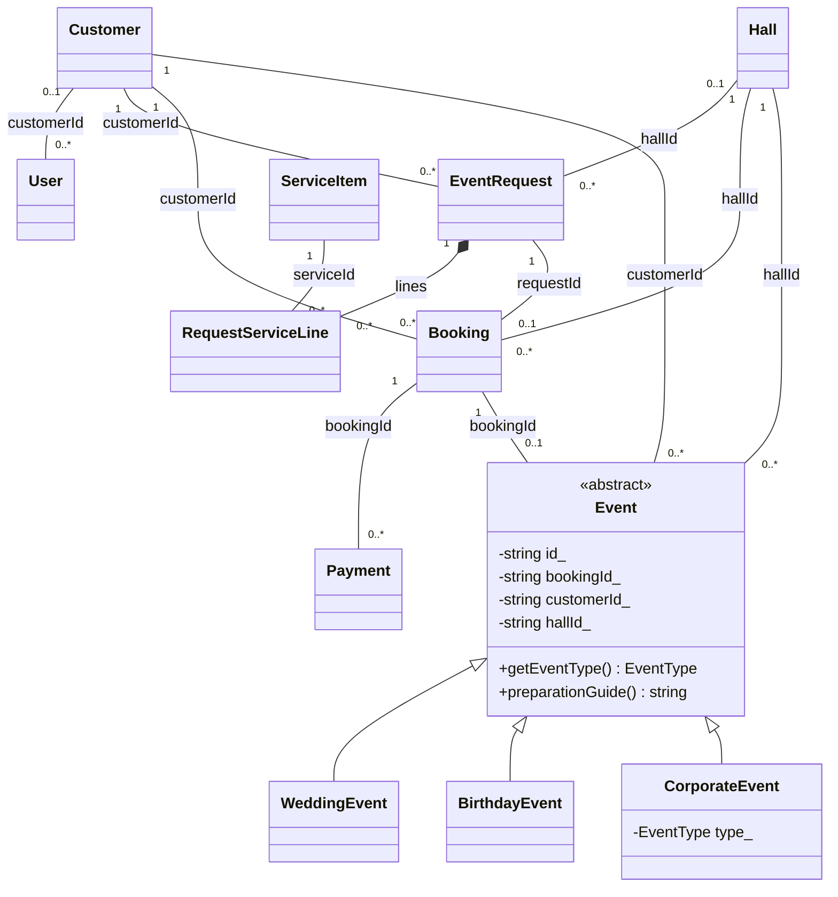

# Đặc tả biểu đồ lớp để sinh XML draw.io

Tài liệu mô tả mã nguồn hiện tại, dùng làm đầu vào cho công cụ sinh XML.
Chương trình dùng Qt và TXT. Tên lớp, thuộc tính và hàm dưới đây giữ theo code.

## 1. Quy ước vẽ

- Mỗi lớp là hình chữ nhật UML có ba ngăn: tên, thuộc tính, phương thức.
- `+` là public, `-` là private. Struct có thuộc tính public.
- Tên lớp trừu tượng `Event` và hàm thuần ảo dùng chữ nghiêng hoặc `{abstract}`.
- Hàm static gạch chân hoặc ghi `{static}`; hàm const ghi `const` ở cuối.
- Kế thừa: đường liền, tam giác rỗng hướng về lớp cha.
- Composition: đường liền, hình thoi đặc ở phía chứa/sở hữu trực tiếp.
- Aggregation/chia sẻ: hình thoi rỗng, có chú thích `shared_ptr` nếu dùng cho danh sách sự kiện.
- Association: đường liền, nhãn trường ID hoặc tên tham chiếu; không thêm hình thoi nếu không sở hữu.
- Dependency: đường nét đứt, mũi tên về lớp được dùng.
- Bội số ghi sát đầu quan hệ tương ứng. ID là liên kết dữ liệu, không phải pointer C++.
- Các nhóm getter/setter có thể rút gọn bằng ghi chú, nhưng không tự thêm hàm chưa có trong code.

Nên chia thành ba trang, tránh một hình chứa quá nhiều chi tiết Qt.

## 2. Trang 1 — Các lớp nghiệp vụ

### User

Nguồn: `src/models/User.cpp`.

```text
- id_: string
- username_: string
- salt_: string
- passwordHash_: string
- fullName_: string
- customerId_: string
- demoPassword_: string
- role_: Role = Customer
- active_: bool = true
+ User()
+ User(id, username, salt, passwordHash, fullName, role, active)
+ id(): const string& const
+ username(): const string& const
+ fullName(): const string& const
+ customerId(): const string& const
+ role(): Role const
+ active(): bool const
+ setRole(v: Role): void
+ setActive(v: bool): void
+ setCustomerId(v: const string&): void
+ setPassword(salt: const string&, hash: const string&): void
+ toFields(): vector<string> const
+ fromFields(f: const vector<string>&): User {static}
```

`demoPassword_` phục vụ dữ liệu demo hiện có; đăng nhập kiểm tra salt/hash.

### Customer

Nguồn: `src/models/Customer.cpp`.

```text
- id_, name_, phone_, email_, address_, notes_: string
- createdAt_: DateTime
- age_: int = 0
+ Customer()
+ Customer(id, name, phone, email, address, notes, createdAt)
+ id(): const string& const
+ name(): const string& const
+ phone(): const string& const
+ age(): int const
+ setName(value: const string&): void
+ setPhone(value: const string&): void
+ setAge(v: int): void
+ toFields(): vector<string> const
+ fromFields(f: const vector<string>&): Customer {static}
```

Có getter/setter tương ứng cho email, địa chỉ, ghi chú. Tuổi 0 trong dữ liệu cũ
nghĩa là chưa biết, còn khách vãng lai mới cần tuổi 1–120.

### Hall

Nguồn: `src/models/Hall.cpp`.

```text
- id_, name_: string
- capacity_: int = 0
- rentalPrice_: int64_t = 0
- status_: HallStatus = KhaDung
+ Hall()
+ Hall(id, name, capacity, rentalPrice, status)
+ id(): const string& const
+ capacity(): int const
+ rentalPrice(): int64_t const
+ status(): HallStatus const
+ active(): bool const
+ setCapacity(v: int): void
+ setRentalPrice(v: int64_t): void
+ setStatus(v: HallStatus): void
+ toFields(): vector<string> const
+ fromFields(f: const vector<string>&): Hall {static}
```

### ServiceItem

Nguồn: `src/models/ServiceItem.cpp`.

```text
- id_, code_, name_, unit_, category_: string
- unitPrice_: int64_t = 0
- active_: bool = true
+ ServiceItem()
+ ServiceItem(id, code, name, unit, unitPrice, category, active)
+ id(): const string& const
+ code(): const string& const
+ unit(): const string& const
+ unitPrice(): int64_t const
+ category(): const string& const
+ active(): bool const
+ setUnitPrice(v: int64_t): void
+ setActive(v: bool): void
+ toFields(): vector<string> const
+ fromFields(f: const vector<string>&): ServiceItem {static}
```

### RequestServiceLine

Nguồn: `src/models/EventRequest.cpp`.

```text
- serviceId_, nameSnapshot_, unitSnapshot_: string
- quantity_: int = 1
- unitPrice_: int64_t = 0
+ RequestServiceLine()
+ RequestServiceLine(serviceId, nameSnapshot, unitSnapshot, quantity, unitPrice)
+ serviceId(): const string& const
+ quantity(): int const
+ unitPrice(): int64_t const
+ amount(): int64_t const
+ setQuantity(v: int): void
+ toFields(): vector<string> const
+ fromFields(f: const vector<string>&): RequestServiceLine {static}
```

`amount() = quantity_ * unitPrice_`. Snapshot là dữ liệu giá/tên lúc chọn dịch vụ,
không phải một bản `ServiceItem` được sở hữu bên trong dòng.

### EventRequest

Nguồn: `src/models/EventRequest.cpp`.

```text
- id_, customerId_, title_, customerName_, customerPhone_, hallId_, notes_: string
- lines_: vector<RequestServiceLine>
- type_: EventType = TiecCuoi
- start_, end_, createdAt_: DateTime
- guestCount_: int = 0
- status_: RequestStatus = Cho
+ EventRequest()
+ EventRequest(id, customerId, type, title, customerName, customerPhone,
                hallId, start, end, guestCount, notes, status)
+ customerId(): const string& const
+ hallId(): const string& const
+ type(): EventType const
+ lines(): const vector<RequestServiceLine>& const
+ lines(): vector<RequestServiceLine>&
+ servicesTotal(): int64_t const
+ setStatus(v: RequestStatus): void
+ toFields(): vector<string> const
+ fromFields(f: const vector<string>&): EventRequest {static}
```

Có getter/setter cho tiêu đề, thông tin khách, sảnh, lịch và số khách.
`hallId_` có thể rỗng khi khách cần tư vấn sảnh.

### Booking

Nguồn: `src/models/Booking.cpp`.

```text
- id_, requestId_, customerId_, hallId_, salesUsername_, cancelReason_: string
- start_, end_, createdAt_, holdUntil_: DateTime
- guestCount_: int = 0
- estimatedTotal_: int64_t = 0
- discountPercent_: int = 0
- discountAmount_: int64_t = 0
- discountNeedsApproval_: bool = false
- discountApproved_: bool = false
- status_: BookingStatus = ChoCoc
+ Booking()
+ Booking(id, requestId, customerId, hallId, start, end, guestCount, estimatedTotal, status)
+ requestId(): const string& const
+ customerId(): const string& const
+ hallId(): const string& const
+ estimatedTotal(): int64_t const
+ finalTotal(): int64_t const
+ occupiesHall(): bool const
+ setDiscount(percent: int, amount: int64_t, needsApproval: bool): void
+ setDiscountApproved(v: bool): void
+ setStatus(v: BookingStatus): void
+ toFields(): vector<string> const
+ fromFields(f: const vector<string>&): Booking {static}
```

`finalTotal() = estimatedTotal_ - discountAmount_`.
`occupiesHall()` đúng khi trạng thái `ChoCoc`, `DaCoc` hoặc `DaThanhToan`.
`DaThanhToan` nghĩa là đã thu đủ tiền, vẫn giữ lịch. `HoanTat` là hoàn tất nghiệp vụ.
`recordPayment()` cập nhật trạng thái theo tổng thu so với `finalTotal()`, không theo nhãn khoản thu.

### Payment

Nguồn: `src/models/Payment.cpp`.

```text
- id_, bookingId_, note_, recordedBy_: string
- amount_: int64_t = 0
- paidAt_: DateTime
- type_: PaymentType = DatCoc1
- method_: PaymentMethod = ChuyenKhoan
- status_: PaymentStatus = ChuaThanhToan
+ Payment()
+ Payment(id, bookingId, type, amount, paidAt, method, status, note, recordedBy)
+ bookingId(): const string& const
+ amount(): int64_t const
+ type(): PaymentType const
+ status(): PaymentStatus const
+ setAmount(v: int64_t): void
+ setStatus(v: PaymentStatus): void
+ toFields(): vector<string> const
+ fromFields(f: const vector<string>&): Payment {static}
```

### Event — abstract

Nguồn: `src/models/Event.cpp`.

```text
- id_, bookingId_, customerId_, hallId_, specialNotes_: string
- start_, end_: DateTime
- status_: EventStatus = SapDienRa
+ Event()
+ Event(id, bookingId, customerId, hallId, start, end, status, specialNotes)
+ ~Event() {virtual}
+ getEventType(): EventType const {abstract, virtual}
+ preparationGuide(): string const {abstract, virtual}
+ id(): const string& const
+ bookingId(): const string& const
+ customerId(): const string& const
+ hallId(): const string& const
+ start(): DateTime const
+ end(): DateTime const
+ status(): EventStatus const
+ setStatus(v: EventStatus): void
+ setSpecialNotes(value: const string&): void
+ toFields(): vector<string> const
+ fromFields(f: const vector<string>&): shared_ptr<Event> {static}
```

### WeddingEvent, BirthdayEvent, CorporateEvent

Cả ba khai báo cùng trong `src/models/Event.cpp`, kế thừa public `Event`.

```text
WeddingEvent
+ WeddingEvent()
+ WeddingEvent(id, bookingId, customerId, hallId, start, end, status, notes)
+ getEventType(): EventType const {override}
+ preparationGuide(): string const {override}

BirthdayEvent
+ BirthdayEvent()
+ BirthdayEvent(id, bookingId, customerId, hallId, start, end, status, notes)
+ getEventType(): EventType const {override}
+ preparationGuide(): string const {override}

CorporateEvent
- type_: EventType
+ CorporateEvent(type, id, bookingId, customerId, hallId, start, end, status, notes)
+ getEventType(): EventType const {override}
+ preparationGuide(): string const {override}
```

Không lặp lại thuộc tính `Event` ở lớp con. `CorporateEvent` gom các nhãn ngoài
tiệc cưới/sinh nhật; không tự thêm `calculateBasePrice()` vì code chưa có hàm này.
`makeEvent(...)` là hàm tự do tạo lớp con, không vẽ thành lớp hay phương thức `Event`.

### Enum sử dụng trong trang nghiệp vụ

Vẽ box `«enumeration»` hoặc ghi vào chú thích để giảm số đường nối:

```text
Role: Customer, Sales, Manager, Operation
EventType: TiecCuoi, SinhNhat, GalaDinner, HoiNghiKhachHang, HoiThao,
           RaMatSanPham, KyNiemThanhLap, TiecTatNien, LeTotNghiep, VanHoa
RequestStatus: Cho, DangTuVan, HoanThanh, BiHuy, DaChot
BookingStatus: ChoCoc, DaCoc, HoanTat, DaHuy, DaThanhToan
HallStatus: KhaDung, BaoTri, KhongKhaDung
PaymentType: DatCoc1, DatCoc2, TatToan
PaymentStatus: ChuaThanhToan, DaThanhToan
PaymentMethod: TienMat, ChuyenKhoan, The
EventStatus: SapDienRa, DangDienRa, DaKetThuc, Huy
```

### Quan hệ và bội số trang 1

| Quan hệ | Loại | Bội số/ghi chú |
| --- | --- | --- |
| WeddingEvent → Event | Kế thừa | Tam giác rỗng tại Event |
| BirthdayEvent → Event | Kế thừa | Tam giác rỗng tại Event |
| CorporateEvent → Event | Kế thừa | Tam giác rỗng tại Event |
| Customer — User | Association `customerId_` | Mỗi User liên kết 0..1 Customer; một Customer có thể có 0..* User theo kiểm tra dữ liệu hiện có |
| Customer — EventRequest | Association `customerId_` | Mỗi yêu cầu có 1 khách; mỗi khách có 0..* yêu cầu |
| Hall — EventRequest | Association `hallId_` | Mỗi yêu cầu chọn 0..1 sảnh; mỗi sảnh có 0..* yêu cầu |
| EventRequest — RequestServiceLine | Composition | Hình thoi đặc tại EventRequest; một yêu cầu có 0..* dòng |
| ServiceItem — RequestServiceLine | Association `serviceId_` | Mỗi dòng liên kết 1 dịch vụ; mỗi dịch vụ có 0..* dòng |
| EventRequest — Booking | Association `requestId_` | Mỗi booking có 1 yêu cầu; một yêu cầu 0..1 booking theo luồng service |
| Customer — Booking | Association `customerId_` | Mỗi booking có 1 khách; mỗi khách 0..* booking |
| Hall — Booking | Association `hallId_` | Mỗi booking có 1 sảnh; mỗi sảnh 0..* booking, có ràng buộc không overlap |
| Booking — Payment | Association `bookingId_` | Mỗi payment có 1 booking; mỗi booking 0..* payment |
| Booking — Event | Association `bookingId_` | Luồng tạo booking tự tạo 1 Event; cho phép 0..1 khi mô tả dữ liệu tổng quát |
| Customer — Event | Association `customerId_` | Mỗi event có 1 khách; mỗi khách 0..* event |
| Hall — Event | Association `hallId_` | Mỗi event có 1 sảnh; mỗi sảnh 0..* event |

Bội số 0..1 booking/yêu cầu và 0..1 event/booking là ràng buộc của **luồng tạo
qua service**. `TextStorage::validate()` kiểm tra tham chiếu và ID nhưng chưa
kiểm tra duy nhất `requestId` trong bookings hoặc `bookingId` trong events.
Nếu vẽ đúng mức bảo đảm của file được nạp, dùng 0..* cho hai đầu này và thêm note
“service tạo tối đa một”. Không ghi ràng buộc database mà code chưa kiểm tra.

## 3. Trang 2 — UI, service và lưu trữ

### Database — struct

Nguồn: `src/models/Database.cpp`. Tất cả thuộc tính public:

```text
+ users: vector<User>
+ customers: vector<Customer>
+ requests: vector<EventRequest>
+ halls: vector<Hall>
+ services: vector<ServiceItem>
+ bookings: vector<Booking>
+ payments: vector<Payment>
+ events: vector<shared_ptr<Event>>
```

### TextStorage

Nguồn: `src/storage/text_storage.cpp`.

```text
- dataDir_, backupDir_: filesystem::path
- db_: Database
- names_: const vector<string>
+ TextStorage(dataDir: filesystem::path, backupDir: filesystem::path)
+ db(): Database&
+ db(): const Database& const
+ dataDir(): const filesystem::path& const
+ load(): void
+ save(): void
- seed(): void
- readRows(name: const string&): vector<vector<string>> const
- writeRows(name: const string&, rows: const vector<vector<string>>&): void const
- validate(data: const Database&): void const
```

### PalaceService

Nguồn: `src/services/palace_service.cpp`. Các phương thức dưới đây là tập tiêu biểu;
giữ ngắn trên hình, dùng note tham chiếu file để xem toàn bộ chữ ký CRUD.

```text
- storage_: TextStorage&
- currentUserId_: string
- guestRequestIds_: vector<string>
+ PalaceService(storage: TextStorage&)
+ login(username: const string&, password: const string&): OpResult
+ logout(): void
+ currentUser(): const User* const
+ can(action: Action): bool const
+ require(action: Action): OpResult const
+ db(): const Database& const
+ searchCustomers(keyword: const string&): vector<Customer> const
+ estimateRequest(req: const EventRequest&): int64_t const
+ validateBookingSlot(hallId, start, end, ignoreBookingId): void const
+ hallAvailable(hallId, start, end, ignoreBookingId, reason): bool const
+ findAvailableHalls(start, end, guestCount, ignoreBookingId): vector<Hall> const
+ createBooking(requestId, hallId, start, end, guestCount, discountPercent, discountAmount): OpResult
+ recordPayment(bookingId, type, amount, method, paidAt, note): OpResult
+ paidAmount(bookingId: const string&): int64_t const
+ sweepExpiredHolds(now: DateTime): int
+ refreshEventStatuses(now: DateTime): int
+ allEvents(): vector<shared_ptr<Event>> const
+ guestRequests(): vector<EventRequest> const
- authenticate(username: const string&, password: const string&): const User& const
- persist(successMessage: const string&, id: const string&): OpResult
- mut(): Database&
- data(): const Database& const
```

Nhóm chức năng bổ sung bằng note: quản lý User, CRUD Customer, Hall, ServiceItem,
EventRequest, Booking, Payment; duyệt giảm giá và lịch sử yêu cầu. Không vẽ thành
các lớp `AuthService`, `BookingService`, `ReportService` vì hiện chưa tách các lớp đó.

### MainWindow — final, kế thừa QMainWindow

Nguồn: `src/ui/app_ui.cpp`.

```text
- service_: PalaceService&
- root_: QStackedWidget*
- navigation_: QComboBox*
- table_: QTableWidget*
- search_: QLineEdit*
- screen_: QString
+ MainWindow(service: PalaceService&)
- notify(result: const OpResult&): void
- getRows(): Rows
- refreshTable(): void
- buildLoginPage(): QWidget*
```

Chỉ cần vẽ một số widget tiêu biểu, không vẽ toàn bộ thư viện Qt. `Rows` là alias
phục vụ hiển thị, không phải một lớp nghiệp vụ mới.

### DateTime — struct

Nguồn: `src/utils/helpers.cpp`.

```text
+ year: int = 1970
+ month: int = 1
+ day: int = 1
+ hour: int = 0
+ minute: int = 0
+ now(): DateTime {static}
+ parse(text: const string&): optional<DateTime> {static}
+ toString(): string const
+ plusHours(hours: int): DateTime const
+ toMinutes(): int64_t const
+ valid(): bool const
```

Các toán tử `<`, `<=`, `==` và `timeOverlaps(...)` là hàm tự do; ghi trong note,
không đưa vào ngăn phương thức thành viên của `DateTime`.

### OpResult — struct

```text
+ ok: bool = false
+ message: string
+ id: string
+ success(message: const string&, id: const string&): OpResult {static}
+ fail(message: const string&): OpResult {static}
```

`Action` là enum của các thao tác phân quyền trong service. `ServiceLineInput`
là struct đầu vào có `serviceId: string`, `quantity: int`; có thể để trong note.

### Quan hệ trang 2

| Quan hệ | Ký hiệu và ý nghĩa |
| --- | --- |
| MainWindow → QMainWindow | Kế thừa, tam giác rỗng tại QMainWindow |
| MainWindow → PalaceService | Association 1–1 trong phiên; `service_` là tham chiếu, không sở hữu |
| PalaceService → TextStorage | Association 1–1 trong ứng dụng; `storage_` không sở hữu |
| TextStorage → Database | Composition 1–1, hình thoi đặc tại TextStorage |
| Database → các model giá trị | Composition 1–0..* với User, Customer, Hall, ServiceItem, EventRequest, Booking, Payment |
| Database → Event | Aggregation/chia sẻ 1–0..*, nhãn `shared_ptr<Event>`; bản sao danh sách cũng có thể giữ đối tượng sống |
| PalaceService → OpResult | Dependency, trả kết quả thao tác |
| MainWindow → OpResult | Dependency, đọc kết quả và hiện thông báo |
| Model dùng DateTime → DateTime | Có thể ghi kiểu thuộc tính, không cần vẽ nhiều cạnh trùng |
| TextStorage → data/*.txt | Dependency đến artifact file, không vẽ file như một lớp |

## 4. Trang 3 — Ngoại lệ

Nguồn: `src/models/Exceptions.cpp`; `StorageError` trong `src/storage/text_storage.cpp`.

```text
std::runtime_error
  ↑ AppException
      ↑ ValidationException
      ↑ NotFoundException
      ↑ DuplicateException
      ↑ BookingConflictException
      ↑ AuthenticationException
      ↑ FileException
          ↑ StorageError
```

Mỗi lớp con có kế thừa public. `AppException` có constructor public
`AppException(message: const string&)` và kế thừa `what()` từ `runtime_error`.
Các lớp con dùng constructor của cha hoặc gọi constructor cha; không có thuộc
tính thông báo mới. Không vẽ `what()` như hàm do từng lớp con tự override.

Dependency nét đứt:

- `PalaceService` → `AuthenticationException`, `NotFoundException`, `ValidationException`, `BookingConflictException`.
- `TextStorage` → `StorageError`, `DuplicateException`.
- Các hàm parse TXT/model → `ValidationException` (có thể dùng note thay cho nhiều cạnh).
- `main()` bắt `std::exception` lúc khởi động; đây là hàm, không tự tạo lớp `Main`.

## 5. Mermaid tham khảo cho trang nghiệp vụ



Hai bội số 0..1 theo luồng service, xem ghi chú ràng buộc trong bảng quan hệ.
Nếu công cụ không hỗ trợ Mermaid, dùng mô tả văn bản các trang ở trên.

## 6. Prompt có thể dùng để sinh XML

Sao chép prompt sau cùng **toàn bộ tài liệu này** vào công cụ sinh XML:

```text
Hãy tạo file XML draw.io theo đặc tả lớp C++ được cung cấp.

Yêu cầu đầu ra:
1. XML không nén, có mxfile và ba diagram; mỗi diagram chứa một mxGraphModel.
2. Ba trang: Nghiep vu, UI-Service-Storage, Ngoai le.
3. Mỗi lớp UML có ba ngăn: tên, thuộc tính, phương thức. Dùng + public, - private.
4. Giữ đúng tên và kiểu theo tài liệu. Viết Event và hàm thuần ảo nghiêng;
   ghi override ở ba lớp con, static ở phương thức tĩnh.
5. Kế thừa dùng tam giác rỗng hướng về cha; composition dùng thoi đặc phía sở hữu;
   association ID không dùng hình thoi; dependency là nét đứt.
6. Đặt bội số theo bảng. Thêm note về shared_ptr và các bội số chỉ được service bảo đảm.
7. Trang nghiệp vụ đặt Event ở trên ba lớp con; chuỗi Customer → EventRequest →
   Booking → Payment ở giữa, Hall và ServiceItem bên dưới, giảm cạnh giao nhau.
8. Trang kiến trúc đặt MainWindow → PalaceService → TextStorage → Database theo
   hàng ngang; dữ liệu TXT là artifact. QMainWindow là lớp thư viện.
9. Trang ngoại lệ đặt runtime_error ở trên cùng, AppException bên dưới,
   sáu nhánh exception tiếp theo và StorageError dưới FileException.
10. Không tự thêm Center, Package, Quotation, Contract, Staff, Table, Incident,
    các service chưa hiện thực hay calculateBasePrice(). Không đổi sang Console/JSON.
11. Dùng ID mxCell duy nhất trong mỗi trang; mỗi edge có source/target hợp lệ;
    escape XML cho &, <, > và dấu nháy trong nhãn, gồm cả kiểu vector/shared_ptr.
12. Dùng cạnh vuông góc, đủ khoảng cách và khung lớp đủ lớn để đọc chữ.

Chỉ trả XML hoàn chỉnh có thể lưu thành TrongDongPalace.drawio và mở bằng draw.io.
```
